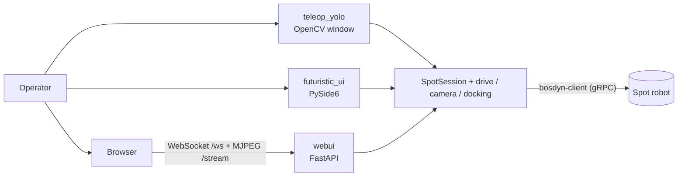

# Mission-2060

Operator consoles for driving a Boston Dynamics Spot robot through the official Spot Python SDK. There are three: an OpenCV teleop window with a YOLOv8 overlay, a PySide6 desktop console and a FastAPI web console.


## Overview

One class, `SpotSession`, handles the whole Spot SDK session: authentication, time sync, the E-Stop endpoint, the lease, power, and stand/sit. Three front-ends are built on top of it. The project was first described as a Spot "reverse engineering" exploration, but all robot access goes through the public `bosdyn-client` / `bosdyn-api` packages.

## Features

**Shared core (`src/mission2060/`)**

- **`config`:** loads connection settings from `.env` with `python-dotenv`.
- **`spot_session.SpotSession`:** a context manager. On start it:
  - authenticates if credentials are set
  - waits for time sync
  - registers its own E-Stop endpoint (9 s timeout) with a keep-alive
  - acquires and keeps a lease
  - powers on the motors and stands the robot

  On shutdown it sits the robot, powers off and stops both keep-alives.
- **`drive`:** stand, sit, stop, and short body-frame velocity commands (`synchro_velocity_command` with an end time).
- **`camera`:** lists image sources and fetches JPEG frames, decoded to OpenCV BGR. It defaults to the five body fisheye cameras. The web and desktop consoles put Spot CAM sources (`spot_cam`, `pano`, `ptz`, `360`, …) first when the robot has them.
- **`docking`:** docks to `SPOT_DOCK_ID`, undocks and reports the current dock ID.
- **`quick_check`:** connects, authenticates and prints the battery percentage.

**Front-ends**

| Module | UI | What it does |
|---|---|---|
| `teleop_yolo` | OpenCV window | Keyboard teleop, HUD text overlay, camera cycling, optional YOLOv8n detection overlay (`yolov8n.pt`), speeds settable from the command line |
| `futuristic_ui` | PySide6 desktop app | Main feed plus four fisheye thumbnails (click one to make it the main feed), latency/FPS overlay, battery bar updated every 1.5 s, hold-to-drive keypad, action buttons, lease release/re-acquire |
| `webui` | Browser (FastAPI + Jinja2) | MJPEG stream per camera at `/stream/{name}`, WebSocket `/ws` for velocity, actions and switching the main camera, on-screen keypad (`ui/`) |

**Controls**

| Key | `teleop_yolo` | `futuristic_ui` / `webui` |
|---|---|---|
| W / S, A / D, Q / E | forward/back, strafe, rotate (one short command per key event) | same axes. `futuristic_ui` resends every 50 ms while held; `webui` sends one 0.35 s command per press |
| Space | stop | – |
| 1 / 2 | stand / sit | stand / sit |
| K / L | E-Stop CUT / allow motor power | E-Stop CUT / allow motor power |
| U / P | undock / dock | undock / dock |
| R / T | – | release / re-acquire lease |
| C / Y | cycle camera / toggle YOLO | – |
| Esc, X, O | exit | – |

## Architecture



## Tech Stack

Python, Boston Dynamics Spot SDK (`bosdyn-client`, `bosdyn-api` ≥ 5.0), OpenCV, NumPy, Ultralytics YOLOv8, PySide6, FastAPI, Jinja2, python-dotenv.

## Setup & Run

You need Python 3.10 or newer (the code uses `X | None` type hints) and a network route to the robot.

```bash
python -m venv .venv && source .venv/bin/activate   # Windows: .venv\Scripts\activate
pip install -r requirements.txt
pip install fastapi uvicorn jinja2   # web console (not listed in requirements.txt)
pip install PySide6                  # desktop console (not listed in requirements.txt)
```

Create a `.env` file in the repository root with these settings:

| Variable | Required | Purpose |
|---|---|---|
| `SPOT_IP` | yes | Robot hostname or IP address |
| `SPOT_USER` | no | Robot username (authentication is skipped if unset) |
| `SPOT_PASSWORD` | no | Robot password |
| `SPOT_DOCK_ID` | no | Integer dock ID, needed for docking |

Run everything from the repository root. The modules use package-relative imports, and `ui/` and `yolov8n.pt` are looked up in the working directory.

```bash
python -m src.mission2060.quick_check     # connectivity + battery check
python -m src.mission2060.teleop_yolo     # options: --speed 0.6 --strafe 0.4 --yaw 0.8 --cmd-dur 0.5 --no-yolo --source <image_source>
python -m src.mission2060.futuristic_ui   # PySide6 console
uvicorn src.mission2060.webui:app         # web console, http://127.0.0.1:8000 by default
```

## Safety Notes

- **Startup moves the robot.** Starting `teleop_yolo`, `futuristic_ui` or `webui` powers on the motors and **stands the robot at once**. For the web console this happens as soon as uvicorn imports the module.
- **The app takes over the E-Stop.** `SpotSession` calls `force_simple_setup()`, which **replaces the robot's existing E-Stop configuration** with this app's single endpoint. If check-ins stop for 9 s, the robot settles and then cuts motor power.
- **CUT drops a standing robot.** **E-Stop CUT (K)** cuts actuator power at once. Use **sit (2)** for a controlled stop where you can. **L** allows power again.
- **Motion commands expire.** Velocity commands last 0.5 s in teleop (default), 0.4 s in the desktop console and 0.35 s in the web console. The robot stops shortly after input stops or the link drops.
- **Only `teleop_yolo` shuts down cleanly.** Its context manager sits the robot and powers off on exit. `futuristic_ui` and `webui` never call `SpotSession.shutdown()`.
- **The web console has no authentication.** Anyone who can reach it can watch the cameras and drive the robot, so keep it on a trusted network.
- **Releasing the lease blocks motion.** After **Release Lease (R)**, motion commands fail until the lease is re-acquired with **T**.

## Project Structure

```
Mission-2060/
├── requirements.txt          # SDK, OpenCV, Ultralytics, python-dotenv, NumPy
├── yolov8n.pt                # YOLOv8 nano weights used by teleop_yolo
├── src/mission2060/
│   ├── config.py             # .env loading -> SpotCredentials
│   ├── spot_session.py       # session lifecycle (auth, E-Stop, lease, power)
│   ├── drive.py              # stand / sit / stop / velocity
│   ├── camera.py             # image sources + JPEG -> BGR
│   ├── docking.py            # dock / undock helpers
│   ├── quick_check.py        # connectivity + battery check
│   ├── teleop_yolo.py        # OpenCV teleop + YOLO overlay
│   ├── futuristic_ui.py      # PySide6 command console
│   └── webui.py              # FastAPI web console
└── ui/                       # web console template, script and styles
    ├── index.html
    ├── app.js
    └── style.css
```

## Team

Awaiz Ahmed is the only committer.

---

Built by [Awaiz Ahmed](https://github.com/4waiz)
